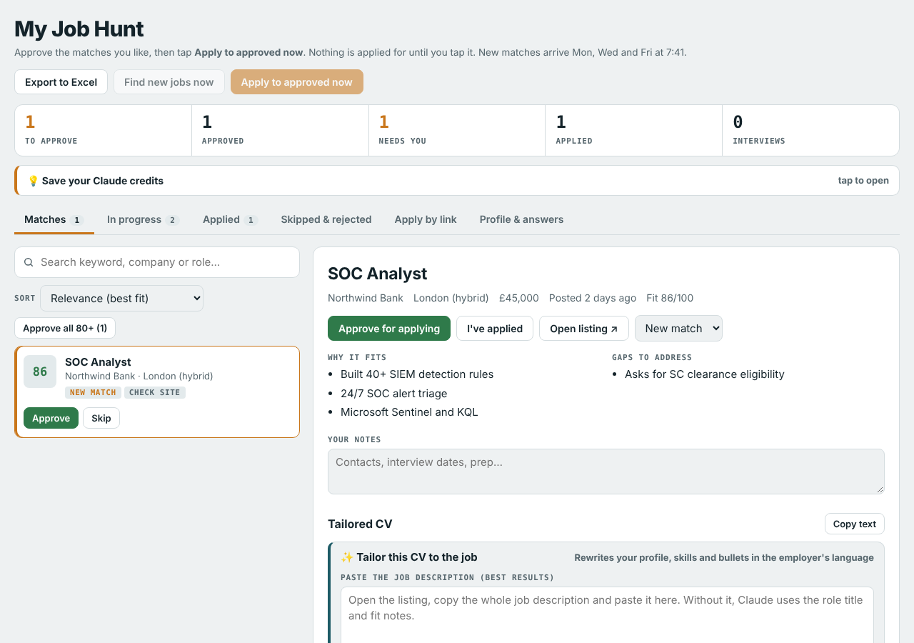

# Job Hunt Assistant

A personal job-hunting app that runs as a **Claude artifact**, paired with a Claude **scheduled task** that finds jobs, tailors your CV to each one, and applies only when you tell it to.

> This repo is a clean template. The profile in `index.html` is a fictional example ("Alex Morgan"); replace it with your own.

## What it does

- **Finds matches.** The scheduled task searches for roles you choose, checks each listing is still open on the employer's own site, scores the fit, and adds the best ones with "why it fits" and "gaps".
- **Tailors your CV per job.** Headline, profile summary, skills and every experience bullet are rewritten in the employer's language for ATS and hiring managers. A guard keeps any line whose numbers don't match your real CV.
- **Applies only on your say-so.** Approve the jobs you like, then tap **Apply to approved now**. Nothing is sent automatically.
- **Apply by link.** Paste jobs you found yourself, then tap **Check my links now** once to process them all in one run.
- **Writing help.** Cover letters and answers to application-form questions, built only from your CV facts.
- **Tracking.** Pipeline counts, search, sort by fit / closing date / easy apply, receipts for each application, skip reasons, and Excel export.
- **PDF downloads.** Download the tailored CV and cover letter for any job.

## Files

| File | What it is |
| --- | --- |
| `index.html` | The whole app: one self-contained page published as a Claude artifact. |
| `scheduled-task-prompt.md` | Template prompt for the Claude scheduled task that searches, tailors and applies. |
| `docs/screenshot.png` | Screenshot with demo data. |

## Set it up

1. **Make it yours.** Open `index.html` and edit the block marked `YOUR PROFILE` near the top of the script: `PROFILE`, `CV` (main CV) and `SUP` (second CV for another kind of role). Only use facts that are true; everything Claude writes is built from them.
2. **Publish it as a Claude artifact** with these capabilities: `db` (stores jobs and settings), `sample` (cover letters, answers, CV tailoring), `downloads` (PDF and Excel), `user`, and `mcp` with the Claude Code Remote connector's `fire_trigger` tool (so the buttons can start a run).
3. **Create the scheduled task** from `scheduled-task-prompt.md`, filling in the placeholders (your name, artifact URL, target roles, locations, deal-breakers).
4. **Connect the two.** Put the task's id (`trig_...`) into `TRIGGER_ID` in `index.html` and republish.
5. **Fill in "Profile & answers"** in the app (salary, notice period, right to work, daily application limit).

Applying uses a browser on your computer, so it needs the Claude desktop app open and the scheduled task set to require that computer.

## Data model

Everything lives in the artifact's database:

- `jobs/<id>`: `title, company, location, salary, seen, url, fit, status, why[], gaps[], caution, notes, jd, tailor{type, headline, summary, skills, bullets, rewrite}, needs, receipt, appliedAt, source, …`
- `settings/answers`: standard application answers and limits.
- `settings/run`: time and summary of the last run.

Statuses: `requested → approved → applying / applied → interview / offer`, plus `review`, `skipped` and `rejected`.

## Saving credits

- Scheduled runs only search; applying happens only when you press the button.
- Add many links, then process them in one run with **Check my links now**.
- Let free job alerts (LinkedIn, Indeed, company sites) find jobs and paste only the good ones.
- Tailor CVs and write cover letters only for jobs you'll actually apply to.

## A note on honesty

Prompts tell Claude to use only facts from your CV, never invent experience, tools or metrics, and answer right-to-work questions truthfully. Always read a tailored CV before you send it, and respect employers who ask applicants not to use AI-generated content.

## License

MIT
